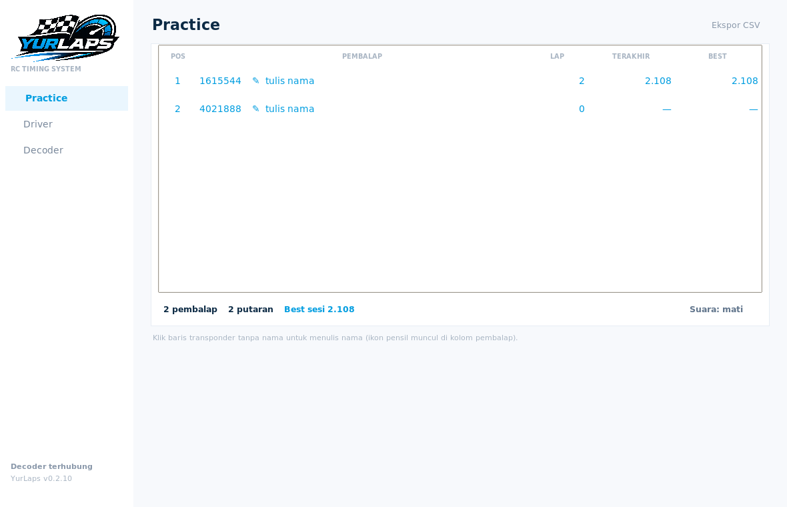
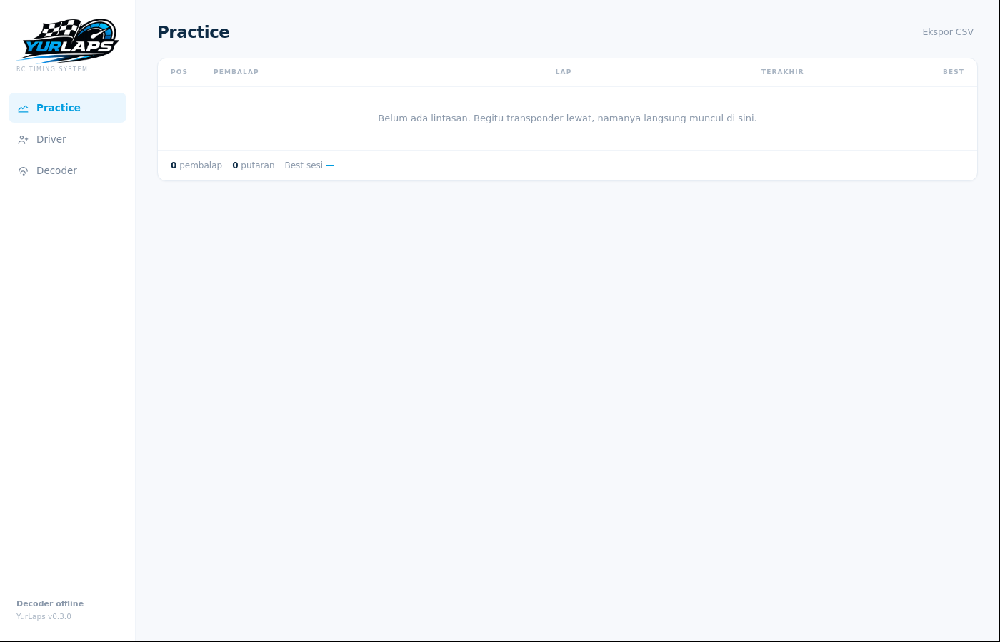
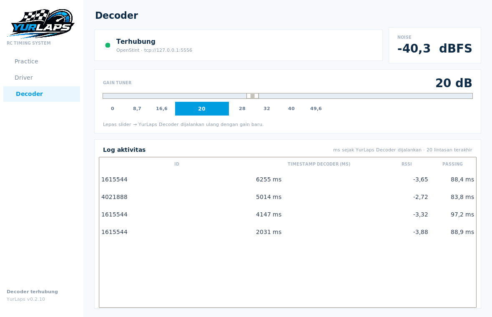
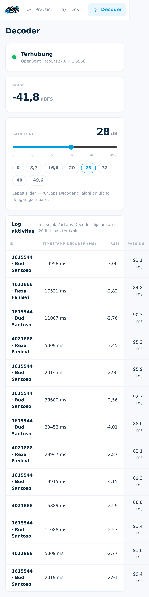

# YurLaps 🏁

Aplikasi lap timing & pencatat stint untuk decoder **OpenStint** — jalan di
**Windows** sebagai aplikasi sendiri (.exe), bisa juga headless di Raspberry Pi /
laptop Linux. Dibuat sebagai alternatif ringan dan terbuka untuk sesi latihan
ala LapBeeps/openstint-lapcounter, dengan tambahan **nama pembalap per
transponder** dan **sinkronisasi hasil ke website online**.




---

## Apa yang sudah bisa dilakukan

| Fitur | Status |
|---|---|
| Baca passing dari decoder OpenStint (ZeroMQ, `tcp://127.0.0.1:5556`) | ✅ |
| **Dua halaman saja**: Practice (timing) & Decoder (radio) | ✅ (v0.2.9) |
| Papan lap live (best / terakhir / jumlah lap), urut best lap | ✅ |
| **Stint otomatis**: lintasan pertama buka stint, idle 2 menit → stint baru | ✅ |
| Data personal per transponder: nama, mobil, kelas, catatan (tersimpan permanen) | ✅ |
| Riwayat lap per stint + RSSI / MER (kualitas sinyal) | ✅ |
| **Halaman Decoder**: gain tuner, noise power, DC offset, jitter, tabel lintasan mentah | ✅ (v0.2.9) |
| **Ubah gain → openstint.exe otomatis dijalankan ulang** | ✅ (v0.2.9) |
| UI baru: sidebar, live timing, detail pembalap, grafik lap (putih–biru) | ✅ (v0.2.9) |
| Anti-ghost: lap lebih cepat dari ambang diabaikan | ✅ |
| Beep tiap lap + beep khusus best lap + pengumuman suara | ✅ |
| Mode **Scoreboard** full-screen untuk TV pit | ✅ |
| Penyimpanan SQLite lokal + ekspor CSV | ✅ |
| Dibuka dari HP/tablet di LAN (`--web`, UI responsif, token opsional) | ✅ opsional |
| Sinkron hasil live ke website (push HTTP JSON **atau** pull) | ✅ opsional |
| Impor/ekspor data transponder (JSON) | ✅ |
| Headless untuk Raspberry Pi appliance | ✅ |
| **Driver YurLaps Decoder otomatis**: deteksi + pasang WinUSB dari dalam aplikasi | ✅ (v0.2) |
| **Decoder dijalankan sendiri**: openstint.exe di latar belakang, restart otomatis | ✅ (v0.2) |
| Aplikasi tetap terbuka walau SDR belum terpasang / decoder mati | ✅ (v0.2) |
| **Pembaruan aplikasi** (cek → unduh → restart & pasang) | ✅ (v0.2) |
| Installer Windows (Inno Setup) + shortcut + uninstall | ✅ (v0.2) |

Belum ada (kandidat v0.2): manajemen heat/final, hitungan mundur start,
handicap, sector timing, klasemen multi-sesi.

---


### Dua berkas "installer" di hasil build — mana yang dipakai?

Build menghasilkan dua `.exe`. Ini disengaja, dan dipakai untuk hal berbeda:

| Berkas | Ukuran | Untuk apa |
|---|---|---|
| **`YurLaps-Setup-0.3.0.exe`** | ±100 MB | **Installer utama — pakai ini.** Dibuat electron-builder (NSIS), sudah memuat aplikasi + decoder. |
| `YurLaps-Setup-0.3.0-full.exe` | ±2 MB | **Alat pembaruan**, bukan untuk dipasang manual. Saat aplikasi memperbarui dirinya, ia menjalankan berkas ini dengan `/UPDATEZIP=<zip>` untuk memasang versi baru dan menyegarkan pintasan/uninstaller. |
| `YurLaps-0.3.0-win.zip` | ±120 MB | Versi portable, tanpa instalasi. |

Kalau kamu hanya ingin memasang YurLaps: **pilih `YurLaps-Setup-0.3.0.exe`**.

Kenapa dua? Karena keduanya harus ada: electron-builder tidak bisa menjalankan
logika pembaruan berbasis zip, dan Inno tidak bisa membungkus jendela Electron
sebagai aplikasi utama di jalur *silent install*.

## Tampilan

Jendela aplikasi sendiri, seperti aplikasi desktop biasa — **tidak ada browser,
tidak ada tab, tidak ada address bar**. Chromium dan mesin timing ikut di dalam
paket, jadi tidak bergantung pada Edge/Chrome yang terpasang di komputer.

Arsitekturnya sama seperti aplikasi timing RC populer (LapBeeps): **jendela
Electron + mesin Python**. Bedanya, mesin YurLaps hanya mendengarkan di
`127.0.0.1` dengan port acak — jadi tidak ada dialog firewall dan UI tidak bisa
dibuka dari komputer lain.

**Semuanya lokal.** Mode native tidak menghubungi internet dan tidak membuka
port: sinkron ke website mati secara bawaan (dan otomatis tidak jalan selama
alamat website masih kosong), cek pembaruan tidak jalan selama URL manifest
kosong, dan tidak ada server HTTP.

| Jendela aplikasi (`YurLaps.exe`) |
|---|
|  |

Tiga halaman, semuanya satu layar penuh tanpa panel bertumpuk:

* **Practice** — pembalap · lap · terakhir · best, plus tombol ekspor CSV.
* **Driver** — pemetaan transponder → nama. Transponder yang belum punya nama
  muncul di Practice dengan tombol pensil; klik, tulis nama, Simpan, dan
  namanya langsung dipakai di Practice serta masuk daftar Driver.
* **Decoder** — status YurLaps Decoder, NOISE (dBFS), gain tuner, dan log
  aktivitas (ID · timestamp decoder · RSSI · passing).

Log menampilkan *timestamp decoder apa adanya dalam milidetik* — itu nilai
`timestamp` dari protokol OpenStint, yaitu lama YurLaps Decoder sudah berjalan
(naik dari 0 setiap kali decoder dijalankan ulang). Lap time dihitung dari
selisih timestamp ini, bukan dari jam komputer, jadi bebas jitter USB/OS.

| Practice — live timing | Decoder — gain, noise, log lintasan |
|---|---|
|  |  |

| Dari HP di LAN (Decoder) |
|---|---|
|  |  |

## 1. Cara menjalankan

Windows, klik dua kali:

```
jalankan.bat
```

Butuh Python 3.10+ ([python.org](https://www.python.org/downloads/windows/),
centang *Add python.exe to PATH*). Aplikasi langsung membuka **jendela
native**-nya sendiri — tidak ada browser, tidak ada tab.

Mau dipakai dari HP/TV juga? Jalankan `YurLaps.exe --web` (atau
`python -m app --web`).

Di Linux/Mac:

```bash
pip install pyzmq
python -m app
```

> **Tidak ada mode demo.** YurLaps hanya menampilkan data yang benar-benar
> datang dari decoder OpenStint lewat ZeroMQ. Kalau belum ada hardware, halaman
> Practice akan menampilkan "Belum ada lintasan" dan halaman Decoder menunjukkan
> apa yang kurang (YurLaps Decoder tidak terdeteksi / driver belum aktif). Ini disengaja:
> tidak ada angka palsu yang bisa tertukar dengan hasil sungguhan.

---

## 2. Pakai dengan decoder OpenStint asli

1. Jalankan decoder OpenStint seperti biasa:
   ```bash
   openstint_rtlsdr -g 20        # atau openstint_hackrf -l 20 -v 20
   ```
   Decoder mem-publish passing ke `tcp://127.0.0.1:5556` (default).
2. Jalankan YurLaps:
   - Windows: `jalankan.bat` (atau `YurLaps.exe` hasil build)
   - Python: `python -m app --port 8080`
3. Saat mobil pertama lewat, kartu pembalap muncul. Klik kartunya → isi
   **nama, kelas, mobil** → Simpan. Data ini menempel pada ID transponder
   selamanya (tersimpan di `config.json` + tabel `drivers`).

> Decoder di komputer lain (mis. Raspberry Pi di trackside)? Ganti
> *Setelan → Endpoint ZeroMQ* menjadi `tcp://192.168.1.50:5556`.

### Arti angka di kartu
- **Best / Terakhir** — waktu lap terbaik dan lap terakhir pada stint aktif.
- **Lap** — total lap hari ini (semua stint).
- **RSSI / MER** — dari decoder; MER > 9 dB bagus, < 3 dB berarti sinyal
  buruk (perbaiki loop/gain). Berguna saat memasang loop di track baru.

---

## 3. Membuat `YurLaps.exe`

### Cara A — otomatis lewat GitHub Actions (tanpa perlu Python/Windows SDK)

1. Push folder ini ke repo GitHub.
2. Tab **Actions** → workflow **Build Windows EXE** → **Run workflow**.
3. Setelah ~3 menit, unduh artifact **YurLaps-windows.zip**.
4. Ekstrak di komputer Windows → jalankan `YurLaps.exe`.

### Cara B — build di komputer Windows sendiri

Klik dua kali `build_exe.bat` (butuh Python 3.10+). Hasil:

```
dist\YurLaps\YurLaps.exe
```

Folder `dist\YurLaps` bisa di-zip dan dipindah ke komputer lain (tidak perlu
Python di sana). Kalau ingin mode portable — data tersimpan di sebelah .exe —
buat file kosong bernama `portable.txt` di folder yang sama dengan `YurLaps.exe`.

### Cara C — cukup pakai Python (paling simpel)

```bash
pip install pyzmq pywebview
python -m app --desktop
```

`--desktop` membuka UI di jendela aplikasi (WebView2). Tanpa `--desktop`,
UI terbuka di browser default.

---

## 4. Dipakai dari HP / TV di LAN

Ya — tapi butuh satu langkah: jalankan YurLaps dalam **mode web**.

```bat
YurLaps.exe --web
```

Di mode ini YurLaps menyalakan server kecil di komputermu (default port 8080),
sehingga HP, tablet, atau TV cukup membuka alamat komputer di browser. Di mode
native (default) tidak ada port yang dibuka sama sekali — lebih aman dan tidak
memunculkan dialog firewall.

**Langkah (sekali saja):**

1. Komputer dan HP tersambung ke **Wi-Fi/router yang sama**
   (hindari Wi-Fi "guest" yang memisahkan perangkat).
2. Jalankan YurLaps. Di log muncul alamat yang bisa langsung dibuka dari HP:

   ```
   Buka dari HP: http://192.168.1.10:8080
   ```

   Alamat yang sama juga tampil di aplikasi (pojok kiri bawah) dan bisa
   diambil lewat `http://localhost:8080/api/state` → field `lan_urls`.
3. Ketik alamat itu di browser HP (ketik manual lebih aman daripada
   memindai QR dari foto).
4. Kalau HP tidak bisa membuka sama sekali padahal alamatnya benar, itu
   **Windows Firewall**. Windows biasanya menanyakan saat pertama jalan —
   pilih **Allow** untuk jaringan **Private**. Kalau dialognya sudah lewat,
   izinkan sekali lewat PowerShell **as Administrator**:

   ```powershell
   New-NetFirewallRule -DisplayName "YurLaps" -Direction Inbound `
     -Protocol TCP -LocalPort 8080 -Action Allow -Profile Private
   ```

   Ini **hanya pengaturan firewall**, bukan pemasangan driver, dan butuh hak
   administrator sekali saja. Tanpa langkah ini aplikasi tetap jalan normal di
   komputer — hanya HP yang tidak bisa membuka.

**Port:** default `8080`. Ganti dengan `--port 9000` kalau bentrok. Kalau port
diganti, izinkan port itu di firewall (angka pada perintah di atas).

**Alamat yang tidak bisa dipakai dari HP:** `localhost`/`127.0.0.1` (itu
komputer itu sendiri) dan `169.254.x.x` (adapter yang tidak mendapat IP dari
router). YurLaps menyembunyikan alamat seperti itu dari daftar.

**Token akses** (opsional, untuk Wi-Fi klub yang dipakai banyak orang): isi di
Setelan. Setelah itu tautan dari YurLaps sudah lengkap dengan `?t=TOKEN`, dan
token ditukar jadi cookie sesi di browser HP supaya tidak tertinggal di URL.

**Layar TV:** buka alamat yang sama di browser TV/tablet, atau tampilkan
jendela aplikasi ke TV lewat HDMI — tampilan menyesuaikan sendiri lebar layar.

---

## 5. Menghubungkan ke website hasil online

### Mode PUSH (disarankan, paling mudah)

YurLaps mengirim snapshot JSON ke website setiap kali ada perubahan:

```
POST https://hasil.klubku.id/api/stintlab/ingest
Authorization: Bearer <token>
Content-Type: application/json
```

Contoh body:

```json
{
  "instance": "Sirkuit RC Medan",
  "track": "Sirkuit RC Medan",
  "event": "Practice Day",
  "session": {"id": 12, "name": "Practice Day", "started_at": 1793715826.2},
  "sent_at": 1793715900.1,
  "drivers": [
    {"transponder_id": 1615544, "transponder_type": "OPN",
     "driver": "Budi Santoso", "car": "Xray X4'24", "class_name": "Mod",
     "note": "", "total_laps": 24, "best_ms": 9042, "last_ms": 9133,
     "stint_index": 2, "stint_open": true,
     "stint_started_at": 1793715700.0, "last_pass_at": 1793715899.8}
  ]
}
```

Server contoh siap pakai: `tools/ingest_server_example.py` (Flask) — sekaligus
menyediakan halaman hasil live sederhana di `http://server:9000/`.

Setelan: halaman **Decoder → Lain-lain** → aktifkan sinkronisasi, isi URL dan token. Tombol **Kirim sekarang (tes)** untuk memastikan server menerima data.

### Mode PULL (tanpa mengirim apa pun keluar)

Website yang mengambil data dari komputer kamu:

```
GET http://IP-KOMPUTER:8080/api/state?t=TOKEN
```

Data yang sama ada di `/api/state` (lengkap dengan riwayat lap). Cocok kalau
kamu sudah punya tunnel (Cloudflare Tunnel / ngrok) atau server di jaringan
yang sama.

### Endpoint lain yang berguna untuk website

| Endpoint | Isi |
|---|---|
| `GET /api/state` | seluruh state: sesi, pembalap, stint, lap, setelan |
| `GET /api/sessions` | daftar sesi tersimpan |
| `GET /api/drivers` | tabel data transponder (personal) |
| `GET /api/mappings.json` | data transponder siap diimpor ke instance lain |
| `POST /api/mappings/import` | impor `{"mappings": {...}}` |
| `GET /api/export.csv` | unduh seluruh lap sesi aktif (CSV) |
| `GET /api/events` | Server-Sent Events, aliran realtime (dipakai UI) |
| `GET /api/health` | status ringan, untuk mencari instance di LAN |

---

## 6. Driver YurLaps Decoder & decoder otomatis (v0.2)

Bagian ini yang membuat YurLaps terasa seperti aplikasi jadi: **pengguna tidak
perlu membuka Zadig atau menjalankan openstint.exe manual.**

### 6.1 Driver YurLaps Decoder

Cek di **Setelan → YurLaps Decoder & driver** (atau halaman **Decoder**) → YurLaps langsung melaporkan:

| Kondisi | Tampilan | Tindakan |
|---|---|---|
| YurLaps Decoder belum tersambung | merah — "tidak terdeteksi" | sambungkan decoder → *Ulangi pemeriksaan* |
| Driver DVB-T bawaan Windows | merah — "perlu WinUSB" | tombol **Pasang driver** |
| WinUSB sudah terpasang | hijau — "siap" | langsung pakai |

Tombol **Pasang driver** memanggil pemasang WinUSB (libwdi). Dua mode:

- jika `vendor/win/wdi-simple.exe` ada → pemasangan **senyap** (`--silent`),
  hanya muncul satu dialog UAC;
- jika tidak ada tetapi `vendor/win/zadig.exe` ada → Zadig terbuka dengan pilihan
  YurLaps Decoder (pengguna klik *Install Driver*) — cara resmi tanpa sertifikat sendiri.

Kalau keduanya tidak dibundel, YurLaps menampilkan **langkah manual** yang
ringkas. Aplikasi tetap berfungsi penuh tanpa driver (data & sesi tidak hilang).

> Kenapa tidak sepenuhnya senyap? Pemasangan driver di Windows **wajib** lewat
> persetujuan administrator (UAC). Dialog itu disengaja oleh Windows — YurLaps
> membuatnya jadi satu klik, bukan mengakalinya.

### 6.2 Decoder dijalankan sendiri + auto-reconnect

Aktif secara default (`Setelan → Decoder → YurLaps yang menjalankan decoder sendiri`):

1. Saat start, YurLaps mencari biner decoder: `decoder_exe` di setelan →
   `vendor/openstint/` → `%APPDATA%\YurLaps\bin\` → `PATH`.
2. Kalau belum ada dan **Unduh decoder otomatis** aktif → unduh rilis resmi
   OpenStint Windows x64 dari GitHub ke `%APPDATA%\YurLaps\bin\` (±23 MB,
   sekali saja, butuh internet).
3. Decoder dijalankan **tanpa jendela hitam** (`CREATE_NO_WINDOW`), argumen
   default `-g 20` (bisa diubah, mis. `-l 20 -v 20` untuk HackRF).
4. **Auto-reconnect**:
   - proses mati (YurLaps Decoder dicabut / crash) → dijalankan ulang, jeda 2 s → 4 s →
     8 s … maksimal 30 s;
   - proses hidup tapi tidak ada data ZeroMQ selama 15 s → restart otomatis;
   - salah platform / biner hilang → berhenti mencoba cepat, muncul pesan jelas.
5. Log decoder disimpan di `%APPDATA%\YurLaps\decoder.log` (4 baris terakhir
   juga ditampilkan di halaman Decoder saat decoder berhenti).

Tombol-tombol terkait:

- **Restart decoder** — paksa mulai ulang;
- **Uji YurLaps Decoder** — jalankan decoder 12 detik lalu tampilkan output aslinya
  (mis. `usb_open error -3`) beserta diagnosis. Ini cara tercepat memastikan
  driver/YurLaps Decoder benar sebelum lomba.

Kalau kamu lebih suka menjalankan decoder sendiri (mis. di Raspberry Pi),
matikan opsi ini — YurLaps akan hanya mendengarkan ZeroMQ seperti v0.1.

---

### 6.3 Halaman **Decoder**: gain, noise, dan lintasan mentah

Buka **Decoder** di sidebar. Halaman ini adalah "ruang mesin" aplikasi, dibagi
tiga kolom kerja:

**a. Gain tuner YurLaps Decoder**

- Slider 0 – 49,6 dB, plus tombol cepat `0 · 8,7 · 16,6 · 20 · 28 · 32 · 40 · 49,6`
  (itu nilai tangga gain yang benar-benar didukung tuner R828D/R820T).
- Geser lalu **lepas** → YurLaps menyimpan `decoder_gain` dan **menjalankan
  ulang `openstint.exe`** otomatis (ada jeda 1,2 detik supaya beberapa geseran
  cepat hanya menghasilkan satu restart). Kalau decoder tidak dikelola YurLaps
  (mode "decoder sendiri"), nilai tetap disimpan tetapi tidak ada restart.
- Yang dikirim ke biner adalah `-g <nilai>`; opsi lain disusun dari setelan
  terstruktur, jadi tidak perlu menyunting teks argumen lagi:

  | Setelan UI | Argumen `openstint_rtlsdr` |
  |---|---|
  | Gain tuner | `-g <0..49.6>` |
  | Bias tee | `-b` |
  | Direct sampling | `-D` |
  | Serial YurLaps Decoder | `-d <serial>` |
  | Pakai jam sistem | `-t` |
  | Monitor mode | `-m` |
  | Argumen tambahan (bebas) | apa adanya, mis. `-s data` |

- Setelan lama seperti `-g 40 -b -m` di `config.json` **dimigrasikan otomatis**
  ke field terstruktur saat aplikasi dibuka (tidak ada yang hilang).

**b. Sinyal & noise (pesan `S`)**

| Kolom | Arti | Patokan |
|---|---|---|
| Noise power | level sinyal rata-rata saat tidak ada transponder (dBFS) | penerimaan andal bila RSSI ≥ noise + 3 dB |
| Jitter p95 | ketelitian decoder (ms), persentil 95 dari 5 detik terakhir | < 3 ms bagus |
| DC offset | ketidakseimbangan mixer | > 10 → turunkan gain |
| Frame diterima/diproses | total vs berhasil di-decoding | selisih besar = RF buruk / LC tidak tuning |

Grafik garis menampilkan noise 90 pesan status terakhir; batang abu-abu di
belakangnya adalah beban frame. Jadi saat antena/loop digeser, kamu bisa lihat
langsung apakah noise-nya membaik.

**c. Lintasan terakhir (pesan `P`)**

Tabel mentah 60 lintasan terakhir — inilah data asli dari decoder, sebelum
diolah menjadi lap:

| Kolom | Dari protokol OpenStint |
|---|---|
| Transponder | `transponder_type` + `transponder_id` (`OPN` / `AMB`) |
| RSSI | kekuatan sinyal (dB, 0 = full scale, positif = clip) |
| MER | kualitas modulasi (dB): < 3 buruk, 3–6 sedang, 6–9 bagus, > 9 emas |
| Hit | jumlah frame valid dalam satu lintasan |
| Durasi | `pass_duration_us` → lama transponder di dalam loop (deteksi kecepatan) |
| TC decoder | `decoder_timestamp` (jam monotonik decoder, milidetik) |
| Lap | hasil hitung YurLaps; baris ditandai `titik nol`, `ghost` (diabaikan, mis. pantulan) atau kosong |

Kolom MER/RSSI diberi warna otomatis sehingga kamu bisa langsung melihat
lintasan mana yang rawan hilang. Semua kolom ini juga tersimpan di database
(`laps.rssi`, `laps.mer`, `laps.pass_duration_us`) dan ikut di ekspor CSV.

**Alur menyetel gain (resep praktis):**

1. Nyalakan transponder, lihat tabel lintasan. MER < 3 dB → naikkan gain 4–8 dB.
2. Gain terlalu tinggi: RSSI mendekati 0/positif dan **DC offset > 10** →
   turunkan gain. Sinyal yang clip justru membuat lap hilang.
3. Target: MER > 9 dB dengan DC offset < 8 dan noise stabil.
4. Ulangi saat posisi antena/loop berubah — nilai terbaik berbeda tiap lintasan.

---

## 7. Pembaruan aplikasi (update)

Supaya pembaruan tidak perlu "kirim zip lewat WhatsApp":

1. Saat build, workflow membuat `update.json` (lewat
   `tools/buat_update_manifest.py`, lengkap dengan `sha256` + ukuran).
2. Unggah zip portable + `update.json` ke hosting apa pun (Vercel, GitHub
   Release, website klub).
3. Di YurLaps: halaman **Decoder → Perangkat/Setelan → URL manifest** →
   `https://…/update.json`. Simpan.
4. Mulai sekarang setiap kali aplikasi dibuka (bila *Periksa pembaruan* aktif)
   YurLaps memeriksa versi. Kalau ada yang baru, muncul keterangan di
   **Setelan → Pembaruan**:
   **Unduh** (dengan progress bar) → **Restart & pasang**.
5. Aplikasi menutup diri, skrip kecil menimpa file lama
   (`robocopy`) dan menjalankannya lagi. **Folder `%APPDATA%\YurLaps` tidak
   disentuh**, jadi semua sesi, lap, dan data pembalap tetap utuh.

Manifest bisa juga dipakai untuk "rilis darurat" — cukup ganti angka `version`,
pengguna akan ditawari versi baru saat membuka aplikasi berikutnya.

---

## 8. Installer Windows (Inno Setup)

Selain versi portable (`YurLaps-portable.zip`), workflow GitHub bisa membuat
**`YurLaps-Setup-0.2.0.exe`** — installer standar Windows:

- wizard modern, pilih folder, shortcut Start Menu + Desktop;
- menawarkan **pasang driver YurLaps Decoder** saat instalasi (bisa dilewati, bisa
  diulang dari dalam aplikasi);
- muncul di *Apps & features* untuk uninstall bersih;
- uninstall **tidak menghapus** data sesi di `%APPDATA%\YurLaps`.

Membangun sendiri: install [Inno Setup 6](https://jrsoftware.org/isdl.php) →
buka `installer/stintlab.iss` → **Build → Compile**.

---

## 9. Data kamu di mana?

```
Windows : %APPDATA%\YurLaps\
Linux   : ~/.stintlab/
```

Isinya:

- `config.json` — setelan + data personal transponder
- `stintlab.sqlite3` — sesi, stint, lap (SQLite; bisa dibuka dengan DB Browser)

Bisa dibaca dari Python lain:

```python
from app.storage import Storage
db = Storage()
for sesi in db.sessions():
    print(sesi)
db.export_session_csv(1, "hasil-sesi-1.csv")
```

Kalau aplikasi ditutup paksa / mati lampu, stint yang masih terbuka dipulihkan
otomatis saat start berikutnya (tidak ada lap yang hilang).

---

## 10. Aturan timing yang dipakai

1. Lintasan **pertama** setiap transponder membuka **stint baru** dan menjadi
   titik nol — tidak dihitung sebagai lap.
2. Lintasan **berikutnya** = lap; waktunya = selisih dengan lintasan sebelumnya.
3. **Idle** lebih lama dari `idle_split_seconds` (default 120 s) menutup stint
   otomatis; lintasan berikutnya membuka stint baru (nomor stint naik).
4. Lap lebih cepat dari `min_lap_seconds` (default 1.5 s) diabaikan sebagai
   pantulan/ghost. Lap yang diabaikan **tidak** menggeser acuan waktu.
5. Semua durasi dihitung dengan `time.monotonic()` — aman dari penyesuaian jam
   sistem (NTP), dan memakai timestamp decoder apa adanya untuk urutan kejadian.

---

## 11. Headless (Raspberry Pi appliance)

```bash
sudo apt install python3-zmq
git clone <repo> stintlab && cd stintlab
python3 -m app --host 0.0.0.0 --port 8080 --no-browser
```

Cocok dipasang permanen di trackside: laptop/RPi menjalankan decoder
OpenStint + YurLaps, semua orang membuka hasilnya dari HP.

Contoh unit systemd ada di `systemd/stintlab.service`.

---

## 12. Struktur proyek

```
app/
  config.py      setelan + data personal transponder (JSON)
  engine.py      mesin timing: passing → lap → stint, statistik, snapshot
  decoder.py     subscriber ZeroMQ OpenStint + simulator decoder
  storage.py     SQLite: sessions / drivers / stints / laps, ekspor CSV
  devices.py     deteksi YurLaps Decoder + pemasangan driver WinUSB (libwdi/Zadig)
  decoder_manager.py  supervisor: jalankan decoder, auto-reconnect, unduh biner
  updater.py     cek/unduh/pasang pembaruan aplikasi
  native.py      UI native Tkinter (default): 3 halaman, tanpa browser
  webapp.py      mode web opsional: server HTTP stdlib + REST API + SSE
  online.py      sinkronisasi ke website hasil (push)
  net.py         deteksi alamat IP LAN
  desktop.py     cadangan: jendela gaya aplikasi via Edge/Chrome (--app-window)
  main.py        entry point CLI
  static/        UI web (satu file HTML) untuk mode --web / HP / TV
desktop/                   jendela aplikasi (Electron)
  src/main/index.js        jalankan mesin + buat jendela; matikan mesin saat ditutup
  src/preload/index.js     jembatan aman (contextIsolation, tanpa Node di UI)
  test/smoke.js            uji jendela tanpa layar (mesin, UI, preload)
installer/
  stintlab.iss             skrip Inno Setup (installer jalur pembaruan)
tools/
  engine.spec              bundel mesin (tanpa Tk) untuk jendela Electron
  engine_entry.py          titik masuk mesin
  fake_decoder.py          decoder OpenStint palsu untuk uji coba
  fetch_vendor.py          unduh Zadig + OpenStint ke vendor/ saat build
  buat_update_manifest.py  hasilkan update.json untuk pembaruan otomatis
  ingest_server_example.py server penerima data online (contoh Flask)
tests/
  native_check.py          uji UI native (dialog nama, Driver, gain, CSV)
  ui_check.py              uji UI web via Playwright (opsional)
  test_smoke.py            logika timing, storage, integrasi ZMQ
  test_integration.py      REST API, SSE, sinkronisasi online
  test_manager.py          supervisor decoder (auto-restart) + updater
```

Teknologi sengaja dipilih konservatif: **Python + stdlib** untuk server,
**SQLite** untuk data, **pyzmq** untuk decoder, **HTML/CSS/JS polos** untuk UI
(tanpa build step, tanpa CDN — jalan offline).

---

## 13. Kompatibilitas Windows

| Windows | Status | Catatan |
|---|---|---|
| **11 / 10 (21H2+)** | ✅ **Satu-satunya target rilis** | Jendela aplikasi via WebView2 bawaan (Electron) |
| 10 versi lama / LTSC | ✅ | Kalau WebView2 belum ada, UI otomatis pindah ke browser |
| 8.1 / 8.0 / 7 | ❌ **Tidak didukung** | Jalur Tk + build Python 3.11 **dihapus** 2026-11-04 (lihat di bawah) |

### Kenapa Windows 8 ke bawah dibuang

Dua batasan resmi, keduanya di luar kendali kami:

- **Chromium (inti Electron) mensyaratkan Windows 10+.** Tidak ada jalan
  membungkus jendela aplikasi di Windows 8.1.
- **Python 3.12+ tidak mendukung Windows 8.1** (PEP 11, dukungan Microsoft
  berakhir 10 Jan 2023). Python 3.11 adalah yang terakhir untuk 8.1, 3.8 untuk
  Windows 7.

Sebelumnya ada jalur alternatif UI Tk untuk Windows 8 — tapi build-nya memakai
Python 3.12, sehingga hasilnya **tidak akan jalan di Windows 8.1** meski
namanya begitu. Daripada memelihara build yang menjanjikan hal yang tidak bisa
diberikan, jalur itu dihapus seluruhnya: job `build-legacy-native` di
`build-windows.yml` dan workflow `build-windows-legacy.yml`.

Berkas `stintlab-win8.spec`, `run_stintlab_win8.py`, dan `jalankan-win8.bat`
**tetap disimpan** (namanya tidak diubah) sebagai bahan bangun manual kalau
suatu hari benar-benar dibutuhkan dengan Python 3.11, tetapi **tidak lagi
diuji di CI** dan tidak didukung.

---

## Lisensi

MIT — bebas dipakai, dimodifikasi, dan dijual untuk klubmu. Nama "LapBeeps",
"OpenStint", dan merek lain milik pemiliknya masing-masing; proyek ini tidak
berafiliasi, hanya berbicara protokol yang sama (dan protokolnya terbuka).
